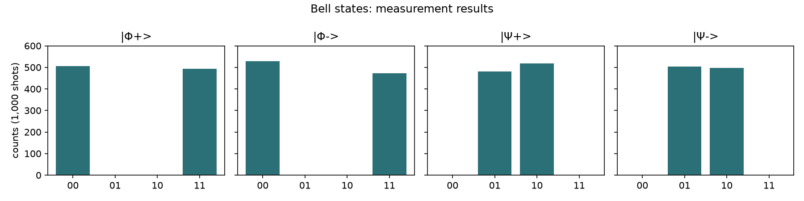

# Day 10 (2026-11-25) 곱 상태와 얽힌 상태: 벨 상태 4개

## 오늘 한 것

- H(0번) + CNOT(0→1)로 벨 상태 `|Φ+>`를 만들고 1,000번 측정 (`day10.py` 1~2번)
- 시작 상태를 X로 바꿔 나머지 세 벨 상태 만들기 (`day10.py` 3번)
- `a·d − b·c`로 곱 상태와 얽힌 상태 구별하기 (`day10.py` 4번)
- 한 큐비트만 보면 반반이라는 것 확인 (`day10.py` 5번)
- 네 벨 상태의 측정 결과 히스토그램 저장 (`bell_histogram.png`)

## 개념 정리

1. **곱 상태**: 두 큐비트 상태의 텐서곱으로 쓸 수 있는 상태. 두 큐비트가 서로 독립이다 (Day 8).
2. **얽힌 상태**: 텐서곱으로 쪼갤 수 없는 상태. 한 큐비트의 결과가 다른 큐비트의 결과와 묶여 있다.
3. 검사법: 두 큐비트 상태 `[a, b, c, d]`가 곱 상태면 `a·d − b·c = 0`이다. 0이 아니면 얽힌 상태다.
4. **벨 상태 4개**
   - `|Φ+> = (|00> + |11>)/√2`: H(0번), CNOT(0→1)
   - `|Φ-> = (|00> − |11>)/√2`: 먼저 X(0번)
   - `|Ψ+> = (|01> + |10>)/√2`: 먼저 X(1번)
   - `|Ψ-> = (|01> − |10>)/√2`: 먼저 X(0번), X(1번). 전체에 −1이 붙어 나오지만 측정으로는 구별되지 않는다
5. Φ 두 개는 측정하면 두 큐비트가 항상 **같고**(00, 11), Ψ 두 개는 항상 **반대**다(01, 10).
6. 한 큐비트만 보면 0과 1이 반반이다. "항상 같다"는 정보는 두 큐비트를 같이 볼 때만 보인다.
7. 네 벨 상태는 서로 겹치지 않는다(내적 0). 그래서 측정으로 서로 구별할 수 있는 한 묶음이다.

## 뽑기 기계로 이해하기

| 용어 | 뽑기 기계로 보면 |
| --- | --- |
| 곱 상태 | 두 기계가 따로 돈다. 한쪽 결과를 알아도 다른 쪽은 모른다 |
| 얽힌 상태 | 두 기계가 한 몸처럼 돈다. 한쪽이 0이면 다른 쪽도 0 (Φ+) |
| 한 큐비트만 보기 | 기계 하나만 보면 그냥 반반짜리 뽑기다 |
| H + CNOT | 첫 기계를 반반으로 돌리고, 그 결과대로 두 번째 기계를 맞춰 놓는 것 |

## 오늘 쓴 코드

| 코드 | 뜻 |
| --- | --- |
| `qc.h(0); qc.cx(0, 1)` | 벨 상태 `|Φ+>` 만들기 |
| `qc.measure_all()` | 모든 큐비트를 측정. 결과 칸도 알아서 만든다 |
| `qc.copy()` | 회로 복사. 원래 회로는 그대로 둔다 |
| `np.vdot(u, v)` | 내적. 0이면 두 상태가 서로 겹치지 않는다 |
| `Statevector.probabilities([0])` | 0번 큐비트만 본 확률 |
| `a * d - b * c` | 곱 상태 검사 |
| `plt.savefig("...png")` | 그림을 파일로 저장 |

## 질문과 답

**Q1. 왜 `a·d − b·c = 0`이면 곱 상태인가?**

`[p, q] ⊗ [r, s] = [pr, ps, qr, qs]`이다. 여기서 `a·d − b·c = pr·qs − ps·qr = 0`이 항상 성립한다. 반대로 이 값이 0이 아니면 어떤 텐서곱으로도 만들 수 없다.

**Q2. CNOT이 왜 얽힘을 만드나?**

H 뒤에는 `0.707|00> + 0.707|01>`이다. 0번이 0인 갈래는 그대로, 0번이 1인 갈래는 1번까지 1로 바뀐다. 그래서 두 갈래가 `|00>`과 `|11>`로 묶인다.

**Q3. 얽혀 있으면 한쪽을 측정했을 때 다른 쪽 결과를 아는 건가?**

`|Φ+>`라면 그렇다. 0번이 0으로 나오면 1번도 반드시 0이다. 측정하면 상태가 어떻게 바뀌는지는 다음 날(부분 측정)에 다룬다.

**Q4. `|Ψ->`에 붙은 −1은 신경 써야 하나?**

상태 전체에 붙은 −1(전체 위상)은 어떤 측정으로도 구별되지 않는다. 그래서 `−(|01> − |10>)/√2`도 같은 `|Ψ->`로 본다.

## 실행 결과 (`day10.py`)

측정 횟수는 실행할 때마다 달라진다. 아래는 한 번 실행한 예다.

- H(0번), CNOT(0→1) 다음 상태: `0.707|00> + 0.707|11>`
- 1,000번 측정: `{'00': 494, '11': 506}`. 01과 10은 한 번도 안 나온다
- `|Φ->: 0.707|00> − 0.707|11>`, `|Ψ+>: 0.707|01> + 0.707|10>`, `|Ψ->: −0.707|01> + 0.707|10>`
- 서로 다른 벨 상태끼리 내적이 모두 0
- `|+>⊗|+>`는 `a·d − b·c = 0`(곱 상태), 벨 상태는 ±0.5(얽힌 상태)
- `|Φ+>`의 0번 큐비트만 본 확률 `[0.5, 0.5]`, 1번만 본 확률 `[0.5, 0.5]`
- 그림 `bell_histogram.png` 저장 (matplotlib 필요: `pip install matplotlib`)

## 다음 (Day 11)

- 부분 측정: 얽힌 큐비트 중 하나만 측정하면 나머지는 어떻게 되나
